# 随手记 · Suishouji

> 像发消息一样记笔记。想到什么打一句就发出去，它会在你的所有设备上同时出现。

一个自己就能跑起来的多人多端速记应用：React 前端 + 一个几十行的 Node 同步服务，
数据存在一个 JSON 文件里，不依赖任何云服务和数据库。

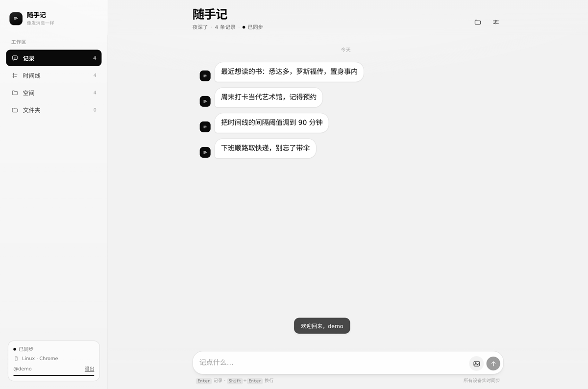

---

## 目录

- [能做什么](#能做什么)
- [技术方案](#技术方案)
- [同步是怎么做的](#同步是怎么做的)
- [快速开始](#快速开始)
- [多端互通怎么用](#多端互通怎么用)
- [配置](#配置)
- [Docker 部署](#docker-部署)
- [快捷键](#快捷键)
- [目录结构](#目录结构)
- [已知限制](#已知限制)

---

## 能做什么

| 能力 | 说明 |
| --- | --- |
| 聊天式速记 | 自己发的记录在右侧（黑底），其他设备的记录在左侧（白底），Enter 直接发送，Shift+Enter 换行，⌘/Ctrl+Enter 也可发送 |
| 账号与隔离 | 注册 / 登录 / 退出；每个账号的数据库记录按 `userId` 分区，服务端任何查询都带用户过滤，A 看不到 B 的任何内容 |
| 游客模式 | 未登录时可正常记录，但**不建立 WebSocket、不写云端**，全部落在本机 IndexedDB；侧栏显示「本地模式」 |
| 登录合并 | 登录/注册时把本机游客记录按 HLC 重放并并入账号，与云端旧记录冲突时按后写覆盖收敛；合并后清空游客分区 |
| 退出不清数据 | 退出登录只停同步、不清记录，刷新后仍在；退出期间的写入会排队，换个账号登录则一条也看不到 |
| 多端实时同步 | 登录后两台设备打开同一地址，任一侧写入 ~100ms 内出现在另一侧；侧边栏只显示同账号的在线设备 |
| 离线可用 | 断网时照常记录，写入先落本机 IndexedDB，恢复网络后自动补发，服务端按 op id 幂等去重 |
| 时间线 | 按发生时间正序铺开所有记录：日期分组、时刻、与上一条的间隔、`#序号/总数`、当天第几条、所属文件夹与来源设备 |
| 空间 / 文件夹 | 「空间」用卡片流回顾全部记录，支持全文搜索与按文件夹筛选；「文件夹」是拟物 3D 图标网格 |
| 归档与置顶 | 单条记录可归档到文件夹、置顶、编辑、删除 |
| 图片 | 支持选择、拖拽、粘贴图片，客户端先等比压缩到 1600px 再入库，单条最多 4 张 |
| 备份 | 设置里可导出 / 导入 JSON，服务端也提供 `/api/export` 整包下载 |
| 深浅两端的适配 | 桌面是三栏（侧栏 + 单列流），移动端是单列 + 底部标签栏，按钮与手势按端区分 |

| 时间线 | 空间 |
| --- | --- |
| 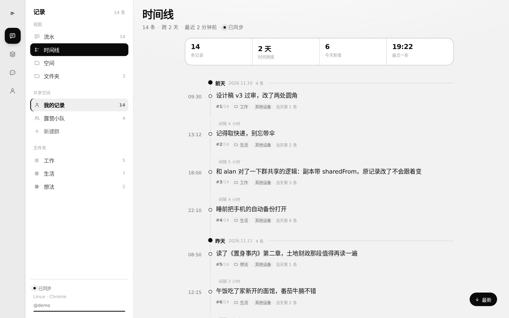 | 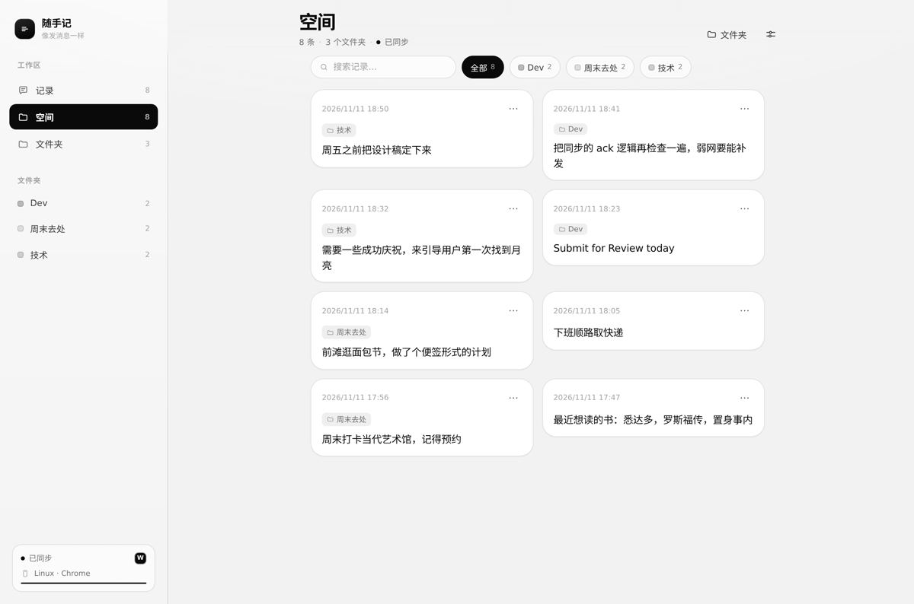 |

| 文件夹 | 移动端 |
| --- | --- |
| 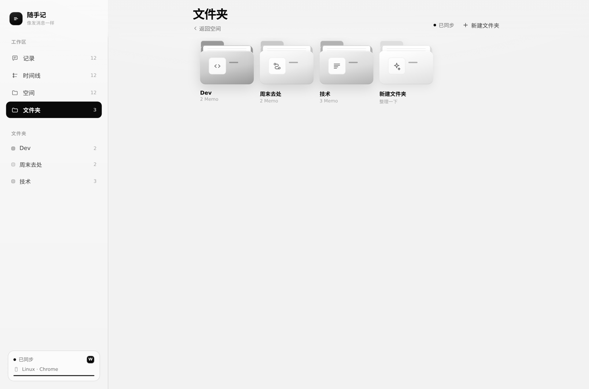 | 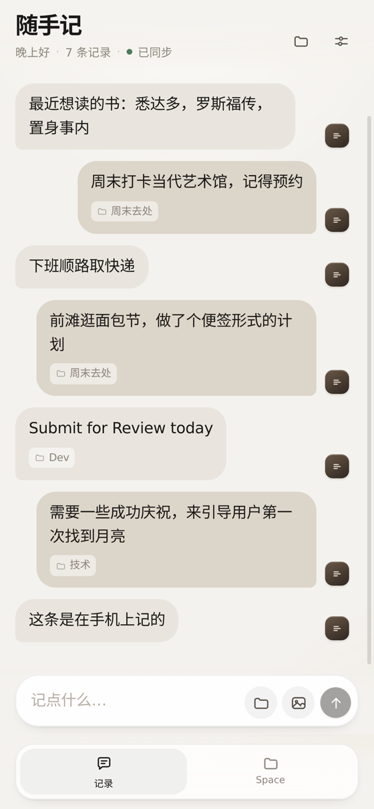 |

---

## 技术方案

### 选型

| 层 | 选择 | 原因 |
| --- | --- | --- |
| 视图 | React 19 + TypeScript | 组件化、生态成熟；严格模式让数据模型无处可藏 |
| 构建 | Vite 6 | 冷启动快，配置面小；生产构建 8s 左右 |
| 动画 | Framer Motion 11 | 弹簧动画、`AnimatePresence` 退场、`layoutId` 滑动指示器都是一行代码级的能力 |
| 状态 | Zustand 5 | 比 Context 少一层重渲染，比 Redux 少一堆样板；store 里直接放业务动作 |
| 样式 | 原生 CSS + 设计令牌 | 黑白高对比：没有强调色，靠反白与边框建立层级；分层阴影、`backdrop-filter`、3D 变换都需要手写控制 |
| 服务端 | Node 22 + `ws` + 原生 `http` | 只有两个职责：静态托管 + 实时同步，不需要框架 |
| 存储 | 单文件 JSON（原子写） | 个人笔记量级（万条内）下最省心的方案，备份就是拷一个文件；记录键为 `userId|entity:id`，天然按账号分区 |
| 认证 | scrypt 口令哈希 + 随机 token | 口令只存盐与哈希，token 存在 localStorage、随 WebSocket hello 一起校验 |
| 本地缓存 | IndexedDB（手写 60 行封装） | 刷新后立刻有内容，不引额外依赖 |

整套只有一个 `package.json`、一套依赖，`npm install` 之后就能跑。

### 架构

```
┌────────────────┐        WebSocket (/ws)        ┌──────────────────────┐
│  浏览器 A        │ ◀──────────────────────────▶ │                      │
│  React + Zustand│                               │  Node 同步服务         │
│  IndexedDB 缓存 │        HTTP (/api/*, 静态)     │  · 操作日志 op log     │
└────────────────┘ ◀──────────────────────────▶ │  · 记录快照 records    │
                                               │  · 在线设备 presence   │
┌────────────────┐        WebSocket             │                      │
│  浏览器 B / 手机  │ ◀──────────────────────────▶ │  持久化 → data/db.json │
└────────────────┘                               └──────────────────────┘
```

服务端不做业务判断，只做三件事：**排序（发 seq）、去重（按 op id）、广播**。
所有冲突消解逻辑都在客户端，两边用同一套规则，因此谁先连上谁后连上都不影响最终结果。

### 数据模型

```ts
type Memo = {
  id: string; text: string; images: string[]; folderId: string | null;
  pinned: boolean; createdAt: number; updatedAt: number;
  hlc: string;        // 最后一次写入的混合逻辑时钟
  deleted: boolean;   // 墓碑，删除也要同步
};
type Folder = { id; name; glyph; tone; createdAt; updatedAt; hlc; deleted };
```

删除是墓碑而不是物理删除：这样「A 设备删除、B 设备离线又编辑」的情况也能收敛到同一个结果。

---

## 同步是怎么做的

### 一次写入 = 一条不可变的 Op

```ts
type Op = {
  id: string;          // 本次操作唯一 id（幂等键）
  entityId: string;    // 被操作的记录 id
  clientId: string;    // 哪台设备写的
  hlc: string;         // 混合逻辑时钟
  entity: 'memo' | 'folder';
  kind: 'put' | 'del';
  data?: Record<string, unknown>;  // put 时携带完整记录
};
```

客户端本地先应用（乐观更新），再把 Op 放进队列，60ms 内的连续操作合并成一批发出。

### 冲突消解：HLC + 后写覆盖

`hlc` 形如 `000001791234567890-0000-a1b2c3d4`：前 16 位是毫秒时间戳，中间 4 位是同毫秒计数器，
最后是设备 id。它保证：

- **因果有序**：收到远端更大的时钟后，本地计数器会推进（`observeHLC`），本机新写入不会排到旧位置；
- **全序可比**：字符串比较即大小，服务端只做 `if (existing.hlc >= op.hlc) return` 这一行判断；
- **时钟回拨安全**：同一毫秒内计数器自增，不依赖系统时钟单调。

同一条记录上，谁的 hlc 更大谁赢——这就是最朴素的 LWW（last-write-wins）。

### 增量拉取与快照重置

服务端给每条 Op 分配单调递增的 `seq`，客户端把已确认的 `seq` 存在 localStorage：

- 连上后发 `hello { since }`，服务端回 `sync { ops: seq > since }`，只补差额；
- 操作日志超过 6000 条会裁剪到 3000 条，`minSeq` 随之上移；如果客户端的 `since` 太旧，
  服务端直接回 `reset { records }` 全量快照，客户端按 hlc 合并（本地更新的记录不会被覆盖）。

### 弱网与重复投递

- 发送后先移到 `inflight`，收到 `ack` 才丢弃；连接断开时把 `inflight` 放回队列重发；
- 服务端记录见过的 op id，重复投递只会原样返回旧的 seq，不会二次写入；
- 断线重连用指数退避（0.6s → 8s，带抖动），`online` 事件和页面重新可见时立即重连。

### 在线设备

每个 WebSocket 连接登记 `clientId / name / platform`，连接与断开时向所有人广播 `presence`。
侧边栏的彩色小方块就是「另一台设备」，点开设置能看到设备名列表。

---

## 快速开始

### 环境

- Node.js **≥ 20.11**（推荐 22）
- 现代浏览器（Chrome / Edge / Safari / Firefox）

### 安装与开发

```bash
npm install
npm run dev
```

- 前端：<http://localhost:5173>
- 同步服务：<http://localhost:8787>（Vite 已把 `/api` 与 `/ws` 代理过去）

### 生产运行

```bash
npm run build     # 产物在 dist/
npm start         # 单端口 8787 同时提供页面、API 与 WebSocket
```

打开 <http://localhost:8787> 即可。数据默认写在 `data/db.json`。

### 环境变量

| 变量 | 默认 | 说明 |
| --- | --- | --- |
| `PORT` | `8787` | 服务端口 |
| `DATA_DIR` | `./data` | 数据目录（单文件 `db.json`） |
| `AI_API_KEY` | 空 | 填了就启用模型（OpenAI 兼容接口），留空走本地引擎 |
| `AI_BASE_URL` | `https://api.openai.com/v1` | 兼容 Kimi / DeepSeek / 本地 vLLM 等 |
| `AI_MODEL` | `gpt-4o-mini` | 模型名 |
| `AI_PROVIDER` | `auto` | `auto` / `openai` / `anthropic` / `gemini` |

> 不配密钥也能用：整理与对话有一套本地确定性引擎（见下文），只是不做生成式推理。


## 多端互通怎么用

1. 在电脑上 `npm start`；
2. 手机与电脑连同一个 Wi-Fi，用手机浏览器打开 `http://<电脑局域网IP>:8787`；
3. 两端侧边栏/设置里会互相看到对方在线，任意一端记录，另一端即时出现。

想让外网也能同步，把服务放到一台有公网 IP 的机器或容器里即可；如果前面挂 Nginx，
记得把 `/ws` 升级为 WebSocket 并透传 `Upgrade`：

```nginx
location / {
  proxy_pass http://127.0.0.1:8787;
  proxy_http_version 1.1;
  proxy_set_header Upgrade $http_upgrade;
  proxy_set_header Connection "upgrade";
  proxy_set_header Host $host;
}
```

HTTPS 下前端会自动把 `ws://` 换成 `wss://`，无需改代码。


---


## 界面结构

界面从「侧栏 + 内容」两栏改成了三级结构，每级只回答一件事：

```
┌──────┬──────────────┬──────────────────────────────┐
│ Rail │ Panel        │ Stage                        │
│ 去哪 │ 有哪些        │ 具体内容                      │
│ 64px │ 272px        │ 自适应                        │
└──────┴──────────────┴──────────────────────────────┘
```

| 级别 | 内容 | 回答的问题 |
| --- | --- | --- |
| 一级（Rail / TabBar） | 记录 / 整理 / 对话 / 我的 | 我要去哪 |
| 二级（Panel） | 记录下：视图（流水 / 时间线 / 空间 / 文件夹）+ 共享空间 + 文件夹；整理下：历史报告；对话下：历史会话 | 这一处里面有哪些集合 |
| 三级（Stage） | 记录流、整理报告、对话流 | 现在我看到的这一份 |

这样改的直接原因：原来「工作区 / 共享 / 文件夹」三组东西平铺在一列侧栏里，层级是扁的——
群和「时间线」看起来是同一级，但它们其实一个是空间、一个是视图。

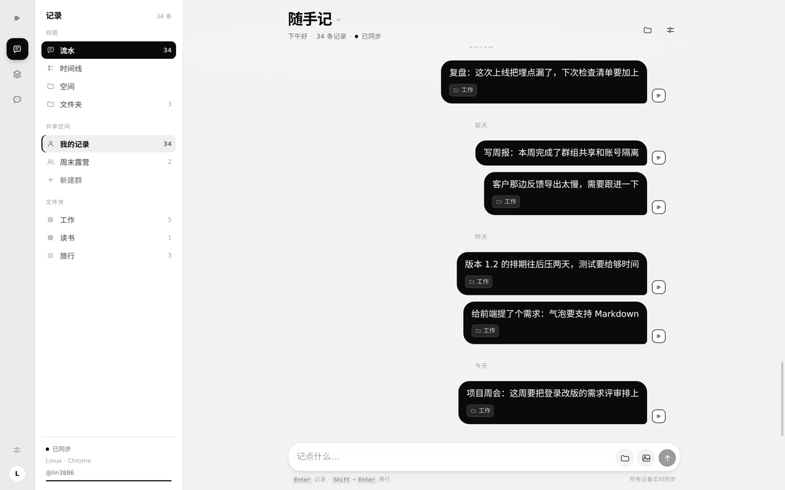

### 响应式

| 宽度 | 布局 |
| --- | --- |
| ≥ 1181px | Rail + Panel + Stage |
| 1025–1180px | Rail 收窄到 64px，Panel 240px |
| 721–1024px | 只留 Rail，Panel 收进顶栏标题的「导航」抽屉；**不显示底部 Tab**（避免和 Rail 重复） |
| ≤ 720px | 只留 Stage，底部 4 个 Tab（记录 / 整理 / 对话 / 我的）；视图与空间从顶栏标题进入 |

`/account`（我的）是**一级页面**，和记录 / 整理 / 对话共用外壳（Rail、TabBar、Toast 都在），
只是它没有二级导航面板——宽屏时 `.app--noPanel` 把中间那列收掉，内容列宽 760，和对话页（720）· 整理页（760）一个节奏。
`/login` 才是独立页（没有 Tab）。

「我的」页内部用 `.acctBody` + `.acctCard`：卡片圆角 16、内边距 15/16、标题 11px 小字，
和 AI 面板里的 `.aiStatusRow` / `.loginGate` 是同一套规格，不再是早先那套 20px 圆角的 `.card`。

移动端的「导航」抽屉和桌面 Panel 是同一份组件（`PanelBody`），只是换了个容器。

#### 窄屏上的几个约定

- **AI 页头部两段式**：≤720px 时 `整理` / `对话` 的头部改成「标题 + 说明」一行、`引擎标签 + 操作按钮` 另一行。
  原来挤在一行时，长模型名（如 `trae-cn/deepseek-v4.1-flash-max`）会被 128px 的 `max-width` 切掉半个字；
  现在标签占满剩余宽度，文字用 `.engineTag__text` 单独一层做省略号，真的放不下才是「…」而不是硬切。
- **对话列表入口**：面板在 ≤1024px 是隐藏的，所以 `对话` 页头部多一个列表按钮（`.chatHistory`），
  点开是 `{kind:'chats'}` 浮层：新对话 / 切换 / 删除（删除是两段式，第二下才真删）。≥1025px 这个按钮隐藏，列表回到左侧面板。
- **「我的」是平级条目**：手机底部 Tab 和桌面 Rail 都是第四项，顺序一致（记录 / 整理 / 对话 / 我的），
  快捷键 `⌘/Ctrl + 4`。桌面上它原来的位置是 Rail 底部的圆形头像按钮——同一个页面两个入口容易混淆，
  头像撤掉后账号名改在「我的」的悬浮提示里（`我的 · @用户名`）。

### 快捷键

| 键 | 作用 |
| --- | --- |
| `⌘/Ctrl + 1 / 2 / 3 / 4` | 记录 / 整理 / 对话 / 我的 |
| `⌘/Ctrl + N` | 回记录并聚焦输入框 |
| `⌘/Ctrl + K` | 回记录并聚焦搜索 |

## AI 整理

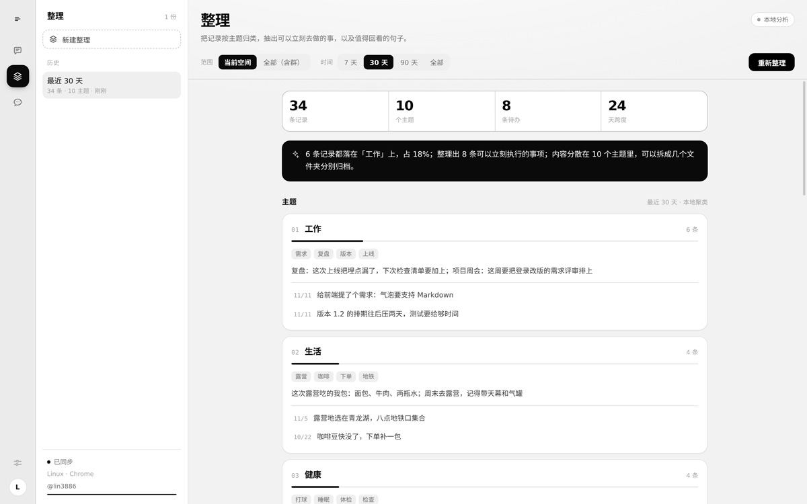

### 它做什么

1. **按主题聚类**：把记录分成 3–8 个主题，给出主题名、关键词、占比条；
2. **摘要**：每个主题用一句概括，并列出「摘要没提到」的代表记录，避免同一句话出现两遍；
3. **抽待办**：按句式线索（记得 / 要 / 截止 / 预约 / 明天…）从原文里摘出可执行项；
4. **值得回看**：带书名号或问号的句子单独拎出来。

主题里的每一条都能点开编辑器；待办点开是它出自的那条记录。

### 范围

- **空间**：当前空间，或「全部（含群）」；
- **时间**：7 / 30 / 90 天 / 全部。

生成的报告存在本机（`ssj:ai:reports:<分区>`），最多留 20 份，按账号分区隔离——切账号看不到别人的整理结果。

### 两种引擎

| 引擎 | 触发条件 | 做法 |
| --- | --- | --- |
| `llm` | 配置了 `AI_API_KEY` | 把记录摘要发给模型，要求返回固定 JSON；解析失败自动退回本地结果 |
| `local` | 未配置 | TF-IDF + 领域词表两级归类、抽句式摘要、正则抽待办 |

本地引擎的归类是**两级**的，这点值得解释：先用领域词表（工作 / 学习 / 生活 / 健康 / 财务 / 购物 / 出行 / 人际 / 想法 / 居所 / 消遣）给每条记录归桶，
领域内记录超过 8 条时再按最高频的实词切一刀；没有命中领域的记录才走相似度聚类。
一开始只做相似度聚类，结果「英语单词」和「家具」被「了一」这种无意义的二元组连在一起——
短句语料里，词表先验比向量相似度可靠得多。

界面右上角的引擎标签会如实显示当前是哪一种，回答末尾也会说明「这是本地检索式回答，没有调用大模型」。

### 配置模型接入

三处入口，改的是同一份配置：

| 入口 | 位置 |
| --- | --- |
| 整理页 | 右上角引擎标签（`本地分析` / `模型 · xxx` / `未就绪 · 去配置`），点一下打开 |
| 对话页 | 同上，右上角 |
| 设置面板 | 「AI」区块 → 配置 |

也可以用环境变量（见上面的环境变量表）。**界面保存的配置优先于环境变量**——否则用户点了保存却没生效。

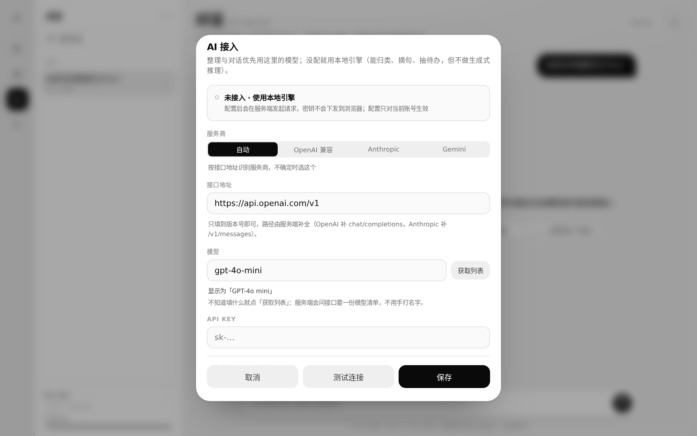

#### 配置项

| 字段 | 说明 | 默认 |
| --- | --- | --- |
| 服务商 | 自动 / OpenAI 兼容 / Anthropic / Gemini | 自动 |
| 接口地址 | 只填到版本号，路径由服务端补 | 按服务商取默认值 |
| 模型 | 模型名，原样传给服务商；可点「获取列表」从接口里挑 | `gpt-4o-mini` |
| API Key | 只存在服务端，前端只回显末四位 | 空 |
| 最大 tokens | 单次回答上限，默认 1024 | 1024 |

#### 模型列表

模型名不用手打：填好地址和 Key 后点输入框右侧的「获取列表」，服务端会带着这份（可能还没保存的）Key
去问接口要一份清单，回来是一个可筛选的面板，点一下就填进输入框。三个协议的取法不同：

| 服务商 | 端点 | 取字段 |
| --- | --- | --- |
| OpenAI 兼容 | `GET {base}/v1/models` | `data[].id` |
| Anthropic | `GET {base}/v1/models?limit=1000` | `data[].id` / `display_name` |
| Gemini | `GET {base}/v1beta/models?pageSize=200&key=` | `models[].name`（去掉 `models/` 前缀） |

几个刻意的处理：

- **过滤不能对话的**：`embedding` / `whisper` / `tts` / `dall-e` / `moderation` 这些拿去 `chat/completions` 一定报错，
  直接从列表里筛掉；万一网关命名不规范把全部筛空了，就保留原样。
- **对话模型排前**：OpenAI 官方列表六十多个，`gpt-4` / `claude` / `deepseek` 这类按名字加权排前面。
- **Key 不外泄**：Gemini 的 key 走 query，回给前端前会洗成 `key=***`。
- **地址改了列表就作废**：模型清单和地址绑定，改完地址会提示重新获取，不会让你点到另一个服务商的模型。
- **网关没实现 /models 也能用**：返回 404/405 时明确告诉你「这个接口没有提供模型清单，只能手填」，不是故障。

对应接口：`POST /api/ai/models`，body `{provider?, baseUrl?, apiKey?}`（都留空就用已保存的配置），
返回 `{models: [{id, label}], provider, endpoint, count}`。

#### 兼容的接口规范

| 服务商 | 端点 | 鉴权 | 流式 | 典型服务 |
| --- | --- | --- | --- | --- |
| `openai` | `POST {base}/v1/chat/completions` | `Authorization: Bearer` | `choices[].delta` | OpenAI、DeepSeek、Kimi、通义、OpenRouter、Ollama、vLLM、OneAPI / New API |
| `anthropic` | `POST {base}/v1/messages` | `x-api-key` + `anthropic-version` | `content_block_delta` | Claude 官方与兼容网关 |
| `gemini` | `POST {base}/v1beta/models/{model}:generateContent?key=` | 查询参数 `key` | `alt=sse` | Google AI Studio |

各协议的差异都在 `server/llm.ts` 里消化掉了：system 消息在 Anthropic 里单独成字段、Gemini 的 `contents[].parts[]` 结构、
JSON 模式三种写法（`response_format` / 提示词约束 / `responseMimeType`）各自适配。

#### 服务商是怎么识别的

1. **显式指定**优先：下拉框选了具体服务商就按它走；
2. 否则**按地址特征匹配**：含 `anthropic` → Anthropic；含 `generativelanguage` 或 `gemini` → Gemini；
3. 其余一律按 **OpenAI 兼容**处理。

第 3 条是刻意的：绝大多数网关（含自建）都是 OpenAI 兼容，认错时的代价也最小——只是路径不同，用户改一下地址即可。
路径补全同样有兜底：地址已含 `/chat/completions` 就直接用，含 `/v1` 就补后半段，两者都没有就补 `/v1/chat/completions`。

#### 存在哪、怎么保密

- **按账号存**：`DATA_DIR/ai/<userId>/ai.json`，写入时 `mode: 0o600`。A 账号填的 Key 不会出现在 B 账号的界面里，
  也不会被 B 账号的整理/对话用掉——之前是一份全局 `data/ai.json`，谁填一次所有账号都变成那个接口，这是个真 bug；
- 读取时只回 `sk-…1234` 这样的末四位，完整 Key 不经过浏览器；
- 清除配置 = 删掉当前账号那个文件，立刻退回本地引擎；
- 环境变量（`AI_API_KEY` / `AI_BASE_URL` / `AI_MODEL`）是全站默认值，只对**没配置过的账号**生效，
  界面上会标注「来自环境变量（全站）」。

升级到按账号存之后，旧那份全局 `data/ai.json` 不会自动发给任何人（那等于没修）。它留在原地，
在 AI 面板里显示成「旧版有一份全站配置（sk-…1234）」，点一下「导入到当前账号」就归你，
**只能被一个账号领走**，领走后其他账号不再看到这个入口（标记写在 `data/ai.json.claimed`）。

#### 排查「not found」

`/api/ai/organize` 返回 `404 {"error":"not found"}` **不是配置问题**，而是请求没匹配到任何路由：

- 服务端进程还是旧代码（路由是后来才加的），`tsx` 不会热重载 → 重启服务即可；
- 反向代理只转发了部分 `/api/*` 路径 → 检查代理规则；
- `npm run build` 之后没重启，前端是新的、后端是旧的。

界面现在会把这类错误翻成人话（见 `friendlyError` / `describeHttpError`）：404 提示重启、401 提示 Key 无效、
429 提示限流、5xx 提示服务商侧故障，不再把服务端原文或 HTML 源码直接抛给用户。
引擎标签也会在接口不可用时显示「未就绪 · 去配置」，而不是假装本地分析可用。

#### 「连接失败 · HTTP 520」是什么

`520`–`526` 是 Cloudflare 专有的状态码，意思是**源站没有返回有效响应**，与你填的 Key、模型名无关。
典型表现：返回体是一大段 HTML（`<!DOCTYPE html>…`）或 `error code: 520`。

排查顺序：

1. 在浏览器里直接打开你填的接口地址（去掉 `/v1` 之后的路径也行）。如果浏览器同样报 520，
   那就是服务商侧的问题，换域名或等它恢复；
2. 过几分钟重试——这类错误经常是短暂的（源站重启、证书更新）；
3. 确认地址没变（不少中转站会换域名），以及地址是否要带 `/v1`。

模型调用失败时，整理不会卡住：它会回退到本地引擎，并在报告顶部写明原因，例如
「模型调用失败，已回退本地引擎。原因：HTTP 520：网关（Cloudflare）表示源站没有正常响应…」——
不会让你误以为那份结果是模型算的。


## AI 对话

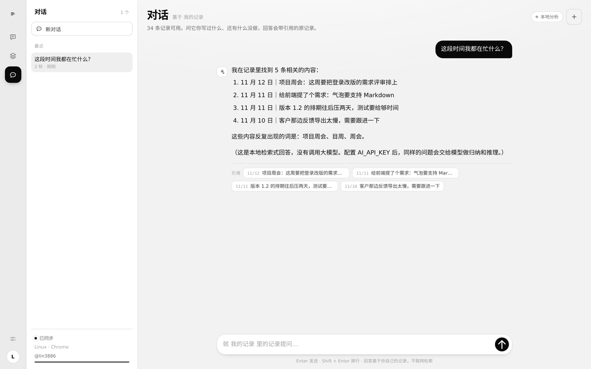

### 交互

- 独立页面 `/chat`，左边是会话列表，右边是消息流 + 输入框，和记录页的「写一条」完全分开；
- 提问后**流式**输出（SSE），可以中途点方块停止；
- 回答下方列出**引用的原记录**，点一下直接打开那条记录的编辑器；
- 顶部的「新对话」建立新会话；会话存在本机（`ssj:ai:chats:<分区>`），刷新不丢；
- 输入框 `Enter` 发送、`Shift + Enter` 换行。

本地引擎的回答走**检索**：按 TF-IDF 找最相关的 5 条，按问题类型组装（问数量给统计、问待办给清单、其余给相关记录 + 高频词），
并在末尾标注没有调用模型。它不会编造不存在的记录。

### 接口

| 方法 | 路径 | 说明 |
| --- | --- | --- |
| GET | `/api/ai/status` | 当前引擎与模型名 |
| POST | `/api/ai/models` | `{provider?, baseUrl?, apiKey?}` → `{models, provider, endpoint, count}` |
| GET | `/api/memo?id=` | 单条记录（带鉴权），本机缺记录时补取 |
| GET | `/api/records` | 全量记录（不含 op 日志），本机数据不全时对齐一次 |
| POST | `/api/ai/organize` | `{spaceId?, days?, folderId?}` → 结构化报告 |
| POST | `/api/ai/chat` | `{messages, spaceId?}` → `text/event-stream`，事件为 `{delta}` / `{done, refs, engine}` |

两个接口都只读当前用户可见的空间，和记录一样按 `userId` / `spaceId` 过滤。

#### 报告里的记录点不开？

整理报告是**服务端**算的，返回的是记录 id；本机如果没同步到那条（换设备、刚在别处写成、
同步游标出过岔子），点开就会是个空浮层。现在的处理：

1. 点之前先看本机有没有，有就直接打开；
2. 没有就 `GET /api/memo?id=` 补这一条，补到就照常打开（顺带拉一次 `/api/records` 把本机其它缺口一起对齐，每会话一次）；
3. 服务端也取不到（真删了、无权访问），弹出提示说清楚，不再给空浮层。

编辑器自身也不会再返回 `null`——记录缺失时给一句「这条记录不在这台设备上」和「知道了」。

## 群组与共享

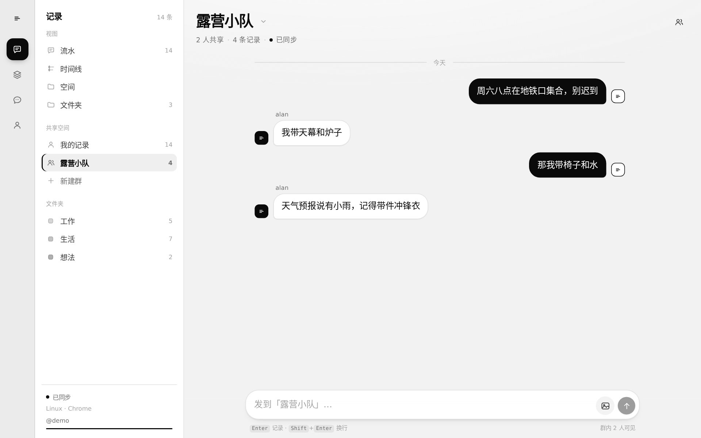

### 空间模型

所有记录都带一个 `spaceId`：

| 空间 | 谁能读写 | 用途 |
| --- | --- | --- |
| `u:<userId>` | 只有本人 | 个人记录，登录前的游客数据在并入后也落在这里 |
| `g:<groupId>` | 群成员（最多 32 人） | 群共享记录，成员实时互通 |

服务端每条读取路径都先算出「当前用户可见的空间集合」，再用它过滤；写操作逐条校验目标空间是否可写，
越权写入直接被丢弃（返回 `applied: 0`），不会报错也不会落库。

### 群操作

- **建群**：桌面在侧栏「共享 → 新建群」；移动端没有侧栏，点顶栏标题打开「切换空间」再点新建群，建完自动进入该群。
- **移动端入口**：顶栏标题（带一个浅色箭头）就是空间切换器，`我的记录` 与各群都在里面；
  「共享」区只列群，不再重复放「我的记录」——那是工作区本身。
- **拉人**：群信息面板里按用户名邀请，多人用逗号或空格分开；对方必须已注册。
  被拉进来的那一刻服务端会给他的连接补发一份全量快照，所以他立刻能看到群里的历史记录。
- **退群 / 移出**：群主可移出成员；群主退出时群主身份自动转给下一位，最后一个人退出则群解散。
  被移出的一侧会收到新的群列表 + 一次全量快照，本地立刻看不到该群内容。
- **共享单条**：个人记录长按 →「共享到『群名』」，群里出现的是一份 `sharedFrom` 指向原记录的副本，
  原记录不受影响，后续编辑也不会同步过去。

### 气泡左右怎么判断

`memo.ownerId` 是创建者的**账号** id，不是设备 id。所以同一个账号在几台设备上写的记录都显示在右侧；
群聊里别人写的在左侧，气泡上方带 `ownerName`。没有 `ownerId` 的老记录按分区判定（个人空间里的必然是自己）。


## 图片为什么曾经有黑边

透明 PNG 从「选图」到「显示」会经过四道，任何一道把透明算成黑色，看起来都是黑边：

| 环节 | 曾经的错误 | 现在的做法 |
| --- | --- | --- |
| 编码 | 统一 `toDataURL('image/jpeg')`，JPEG 没有 alpha，透明像素被写成 `#000` | 先检测 alpha，带透明走 WebP（不支持则 PNG），只有不透明照片才压 JPEG 并先铺白底 |
| 检测 | 64×64 稀疏采样，图标类 PNG 的透明只在四角，容易整格落在不透明区上被误判 | 192×192 采样 + **四条边逐像素扫描**（透明图几乎总有贴边像素） |
| 气泡 | `.row--me .bubble`（权重 0,2,0）覆盖了 `.bubble--media`（0,1,0）的 `background` / `border-color`，深色底和 1px 描边又回来了 | 选择器提到 `.row--me .bubble.bubble--media`（0,3,0），并且边框用 `border: 0` 而不是 `transparent`（transparent 仍占 1px 并参与背景裁剪） |
| 叠层 | 新消息的 `bubbleGlow` 动画会投一圈 6px 的 `rgba(10,10,10,.08)` 阴影 | 纯图气泡 `animation: none` |

另外两处细节：

- 深色气泡里给图片垫了一块 **4px 浅色底板**（`padding: 4px; border-radius: 13px`），图片不再与深色直接相邻；
  底板圆角必须 **≤ 图片圆角**，圆角越大弧线越往里收，图片四个角尖会落到弧外，反而露出深色——这就是最后一版还残留几个黑点的原因。
- 纯图气泡 `overflow: hidden` + 图片 `border-radius: 0`，圆角只由气泡裁一次，避免两层圆角之间露底色。

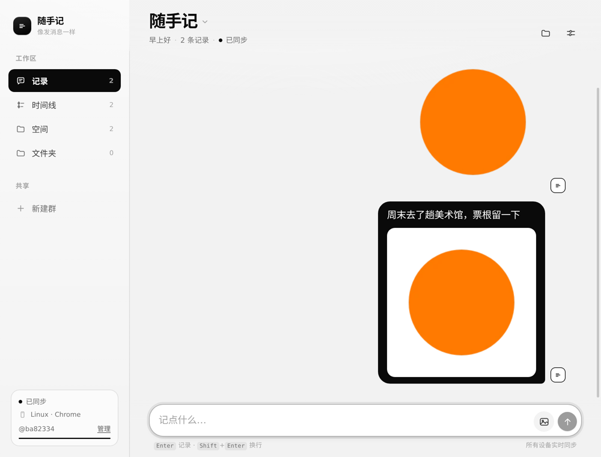

### 怎么自己确认黑边没了

浏览器里贴到控制台（先在页面里发一张透明 PNG）：

```js
const b = document.querySelector('.bubble--media');
const img = b.querySelector('.bubble__img');
const br = b.getBoundingClientRect(), ir = img.getBoundingClientRect();
const cs = getComputedStyle(b);
console.log('边框', cs.borderTopWidth, cs.borderTopColor, '底色', cs.backgroundColor);
console.log('图片相对气泡的偏移', ir.x - br.x, ir.y - br.y, '尺寸差', br.width - ir.width, br.height - ir.height);
```

期望输出：`边框 0px`、`底色 rgba(0, 0, 0, 0)`、偏移与尺寸差都是 `0`。

像素级判定（本仓库就是这么做验证的）：对气泡元素截图后统计亮度 `luma = 0.299R + 0.587G + 0.114B`，
最外 3px 环带应当 **没有一个像素 luma < 80**；图片矩形向外扩 1px 的环带应当是纯浅色。

## 账号路由

登录和账号管理不再挤在底部抽屉里，而是两个真正的页面：

| 路径 | 内容 | 入口 |
| --- | --- | --- |
| `/login` | 登录 / 注册表单，成功后回 `/` | 侧栏账号行「登录」、设置页「登录」、`/account` 里的按钮 |
| `/account` | 账号信息、设备、所在群、退出登录、清除本机缓存 | 侧栏 `@用户名 · 管理`、设置页「管理」 |

实现是一个 40 行的 `useRoute()`（`pushState` + `popstate` 监听），没引路由库。
服务端对未知路径统一回 `index.html`，所以刷新 `/account` 不会 404。

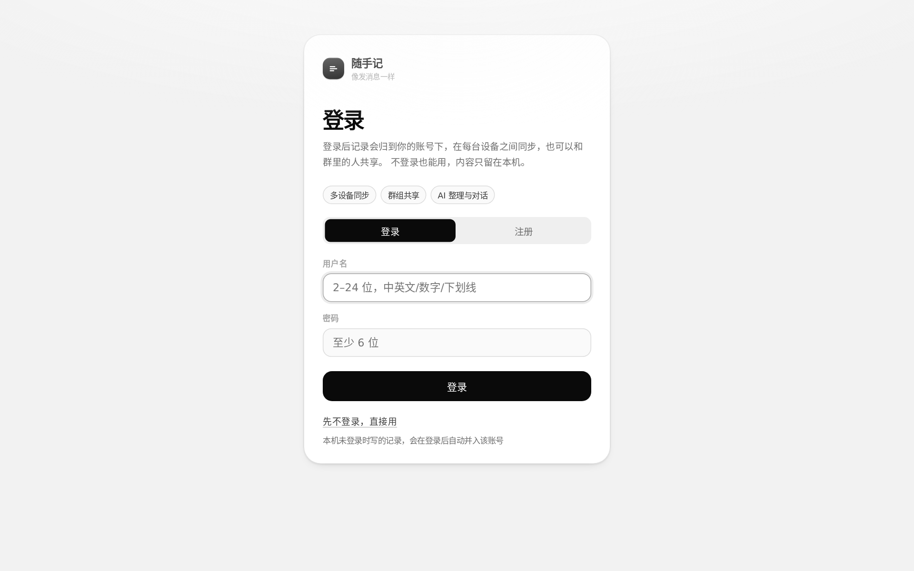

## 账号与数据隔离

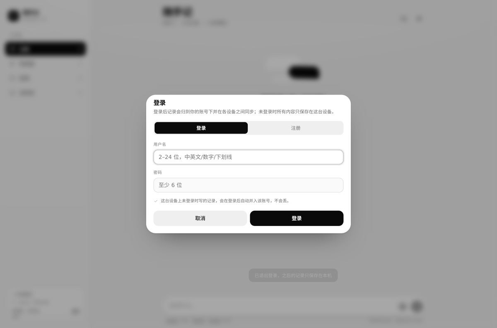

### 四种状态

| 状态 | 数据落点 | 是否联网 | 界面提示 |
| --- | --- | --- | --- |
| 未登录（游客） | 仅本机 IndexedDB（`state:guest`） | 不建立 WebSocket | 徽标「本地模式」，侧栏「未登录 · 仅本机」 |
| 已登录 | 本机分区 `state:u:<userId>` + 云端该账号分区 | 实时同步 | 徽标「已同步」，侧栏 `@用户名` |
| 已退出 | 仍是 `state:u:<userId>`，原样保留 | 断开 | 侧栏 `@用户名 · 已退出`，输入框提示「只写在本机」 |
| 登录失效 | 同「已退出」 | 断开 | 顶部提示「登录已失效，记录仍留在本机」 |

### 登录时发生了什么

1. 把当前游客分区与目标账号在本机的快照按 `hlc` 合并（后写覆盖）；
2. 写入账号分区，同时清空游客分区，避免同一条记录以游客身份再次出现；
3. 把**来自游客的那部分记录**按原 `hlc` 重放为 Op 推给服务端——服务端只接受比现有版本更新的写入，
   所以「本地较旧、云端较新」的情况不会被本地覆盖；
4. 建立 WebSocket，用该账号的 `since` 做增量拉取，补齐其他设备写入的内容。

### 退出登录

退出只做三件事：把当前内容写盘、断开 WebSocket、清掉 token。**内存和 IndexedDB 里的记录一条都不动**，
刷新也还在（`ssj:lastBucket` 记住上次看的是哪个分区，`ssj:lastUser` 记住侧栏该显示谁）。

退出期间照常能写：新记录写进该账号的分区，同时进入该分区的待发队列（`pending:u:<userId>`）。
下次登录同一账号，队列自动补传；登录另一个账号则完全看不到这批内容——分区不同，不合并。

真想清掉本机这份缓存，用设置页的「清除本机缓存」（两段确认，只删本机，云端不动）。

### 接口

| 方法 | 路径 | 说明 |
| --- | --- | --- |
| POST | `/api/auth/register` | `{username, password}` → `{token, user}`；用户名重复返回 409 |
| POST | `/api/auth/login` | 同上，口令错误返回 401 |
| POST | `/api/auth/logout` | 需 `Authorization: Bearer <token>`，使 token 失效 |
| GET | `/api/auth/me` | 校验 token，返回当前用户 |
| GET | `/api/snapshot?since=N` | 需登录，只返回该用户的增量或快照 |
| POST | `/api/ops` | 需登录，写入该用户分区 |
| GET | `/api/export` | 需登录，导出该用户全部记录（含所在群） |
| GET | `/api/groups` | 需登录，返回自己所在的群 |
| POST | `/api/groups` | `{name}` 建群 |
| POST | `/api/groups/invite` | `{groupId, usernames[]}` 拉人 |
| POST | `/api/groups/rename` | `{groupId, name}` 改名 |
| POST | `/api/groups/remove` | `{groupId, userId}` 群主移出成员 |
| POST | `/api/groups/leave` | `{groupId}` 退群 |

### 安全边界（务必阅读）

- 口令用 `scrypt` + 每用户随机盐哈希，比对用 `timingSafeEqual`；服务端不存明文口令。
- **记录本身没有端到端加密**：能读到 `data/db.json` 的人可以读到全部内容。要真正做到「服务端也看不见」，需要再加一层客户端加密。
- token 存在 `localStorage`，有效期不设上限（服务端可随时删除）。公网部署请务必上 HTTPS，否则 token 会在链路上裸奔。
- 没有找回密码、邮箱验证、登录失败限流，这三件事属于「生产必需、示例不做」的范围。
- 群没有邀请链接、二维码、管理员角色，只能按用户名拉人；群主权限只有「改名」和「移出成员」。
- 本地 AI 引擎是**抽取式**的：它归类、摘句、抽待办，但不做推理和改写；想要真正的生成能力就配 `AI_API_KEY`。
- 对话与整理结果只存本机，不参与多端同步。

---

## 下载与安装

到 [Releases](https://github.com/Ysur007/suishouji-app/releases) 下载对应平台的包：

| 平台 | 文件 | 怎么用 |
| --- | --- | --- |
| Windows x64 | `suishouji-1.1.0-win-x64.zip` | 解压到任意目录，双击 `Suishouji.exe`。**未签名**，首次运行 SmartScreen 会拦：更多信息 → 仍要运行 |
| Android | `suishouji-1.1.0-android.apk` | 传到手机安装，需要允许「安装未知来源应用」。debug 签名，适合自用 |
| Web | `suishouji-1.1.0-web.zip` | 解压到任意静态服务器；或 `npm ci && npm run build && npm start` |

### 三端各自是什么

- **Web**：就是这套前端 + Node 服务端，数据在服务端。
- **Windows（Electron）**：把前端和服务端**一起**打进 exe，启动时在 `127.0.0.1:8787` 起本地服务，窗口加载它。
  因此桌面版**开箱即用、不依赖任何远程服务器**，数据在 `%APPDATA%\Suishouji\data\db.json`。
  代价是它默认是个独立实例：想让桌面版连到线上那份数据，用 `SSJ_REMOTE=https://你的地址` 启动，
  它会跳过本地服务直接当客户端。
- **Android（Capacitor）**：页面打包在 app 内，接口指向构建时注入的服务器地址。
  换服务器不用重新打包——在「账号 → 服务器」里填地址，保存后自动重载。

> 三端是同一份前端代码，只有"接口地址"和"数据放在哪"不同。

### Android 返回键

Capacitor 壳默认把返回键交给 Activity：WebView 能回退就回退，否则直接 `finish()`。
而这个应用的 tab、空间切换都不写 history，所以「在首页按返回」= 直接退回桌面。

现在接管了返回键，只回退「真正的上下级」，平级页面之间不互相回退：

1. 图片预览 / 抽屉 / 右键菜单 / 文件夹选择器 → 关掉最上面那层
2. 在 `/login`、`/account` → 回到应用
3. 已经在一级页面（记录 / 时间线 / 空间 / 文件夹 / 任意群）→ `minimizeApp()` 直接退到后台

一级页面（几个 tab、各个群）是平级的：在时间线按返回**直接退到桌面**，不会先跳回记录页。
退到后台不杀进程，数据与长连接都保留。

实现见 `src/lib/backbutton.ts`：用 `@capacitor/app` 的 `backButton` 事件接管，只在原生平台生效，
浏览器和 Electron 里不受影响。

### 图片预览

预览是叠在页面之上的独立一层（不占抽屉槽位），所以：

- 右上角有明确的关闭按钮，也支持点背景、按 Esc、按返回键关闭
- 从编辑器里点开的图片，关掉后回到**编辑器**，不是掉回列表
- 上传前会压一道图：**带透明的图走 WebP/PNG**（JPEG 没有 alpha 通道，透明像素会编码成黑色），
  只有不透明的照片才压 JPEG，并先铺白底
- 纯图片记录（无文字）去掉气泡内边距、边框与底色，图片本身就是气泡
- 预览图按视口约束（`calc(100vw - 20px)` / `calc(100dvh - 20px)` + `object-fit: contain`），
  几乎铺满整屏只留 10px 呼吸位，横图竖图都完整可见，不会出现很厚的黑边


## Docker 部署

```bash
docker compose up -d --build
# 访问 http://localhost:8787
```

`docker-compose.yml` 已把 `./data` 挂载到容器内，升级镜像不会丢数据。

---

## 快捷键

| 快捷键 | 作用 |
| --- | --- |
| `Enter` | 发送当前记录 |
| `Shift + Enter` | 换行 |
| `⌘ / Ctrl + Enter` | 在编辑面板中保存 |
| `⌘ / Ctrl + N` | 跳到输入框 |
| `⌘ / Ctrl + K` | 跳到「空间」并聚焦搜索 |
| `Esc` | 关闭菜单 / 面板 / 图片预览 |

移动端：长按气泡弹出操作菜单（复制 / 编辑 / 置顶 / 归档 / 删除），点击气泡进入编辑。

---

## 目录结构

```
.
├── server/
│   ├── index.ts        # HTTP + WebSocket + 静态托管
│   ├── store.ts        # 操作日志、快照、原子写盘
│   └── types.ts        # 同步协议类型
├── src/
│   ├── components/     # 视图与交互组件
│   ├── lib/
│   │   ├── store.ts    # Zustand store：数据 + 业务动作
│   │   ├── sync.ts     # WebSocket 客户端：队列、重连、增量
│   │   ├── hlc.ts      # 混合逻辑时钟
│   │   ├── idb.ts      # IndexedDB 键值封装
│   │   └── bus.ts      # store → sync 的操作总线
│   ├── styles/         # 设计令牌 + 组件样式
│   └── App.tsx
├── DESIGN.md           # 设计系统说明
└── vite.config.ts
```

---

## 已知限制

- 数据是**单文件 JSON + 全量内存**，适合个人 / 小团队；如果要几十人并发写，换 SQLite 或 Postgres 更合适（Op 模型不用改，只换持久化层）。
- 账号体系是最小实现：没有找回密码、邮箱验证、登录失败限流；token 长期有效且存在 localStorage。
- 记录没有端到端加密，服务端可读；`data/db.json` 里能看到所有账号的明文内容。
- 图片以 base64 存在记录里，单条 4 张、每张压到 1600px 以内；如果要大量放图，应该改成对象存储 + URL 引用。
- 冲突策略是整条记录级的「后写覆盖」，两个人在同一秒改同一条记录会丢掉其中一次修改（个人速记场景可以接受，需要逐字合并就得换成 CRDT）。
