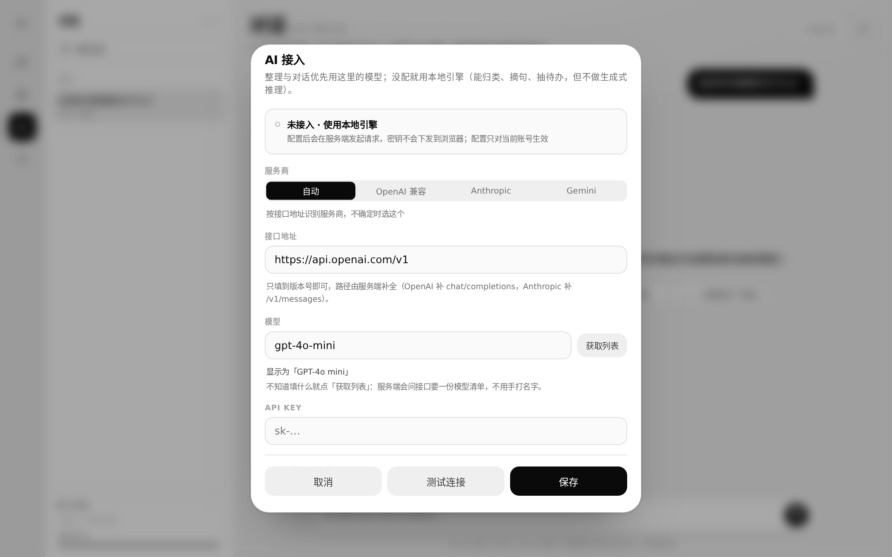
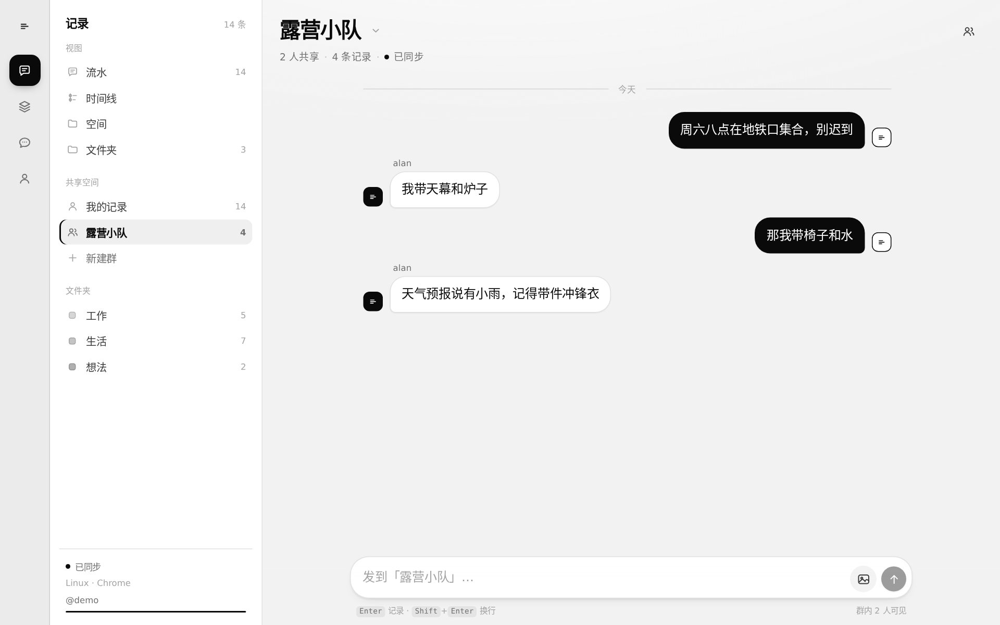
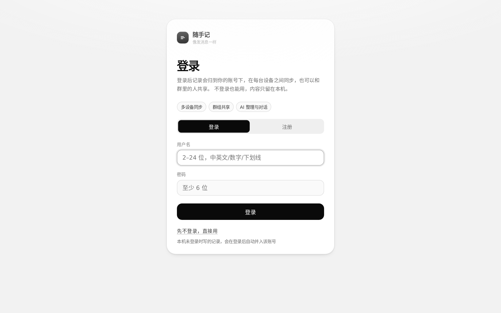
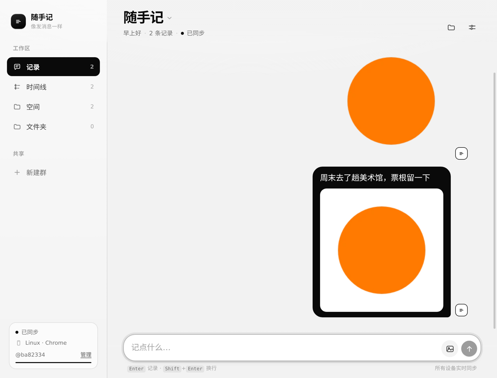

# 技术札记

README 放不下的实现细节都在这里。想快速上手看 [README](../README.md)；
想知道「为什么这么写」看这里，或者 [DESIGN.md](../DESIGN.md)（设计系统）。

## 目录

- [技术方案](#技术方案)
- [同步是怎么做的](#同步是怎么做的)
- [模型接入：协议与排错](#模型接入协议与排错)
- [群组与共享](#群组与共享)
- [路由](#路由)
- [接口一览](#接口一览)
- [图片为什么曾经有黑边](#图片为什么曾经有黑边)
- [账号接口](#账号接口)
- [Android 返回键](#android-返回键)
- [图片预览](#图片预览)
- [目录结构](#目录结构)


---

## 技术方案

### 选型

| 层 | 选择 | 原因 |
| --- | --- | --- |
| 视图 | React 19 + TypeScript | 组件化、生态成熟；严格模式让数据模型无处可藏 |
| 构建 | Vite 6 | 冷启动快，配置面小；生产构建 8s 左右 |
| 动画 | Framer Motion 11 | 弹簧动画、`AnimatePresence` 退场、`layoutId` 滑动指示器都是一行代码级的能力 |
| 状态 | Zustand 5 | 比 Context 少一层重渲染，比 Redux 少一堆样板；store 里直接放业务动作 |
| 样式 | 原生 CSS + 设计令牌 | 黑白高对比：没有强调色，靠反白与边框建立层级；分层阴影、`backdrop-filter`、3D 变换都需要手写控制 |
| 服务端 | Node 22 + `ws` + 原生 `http` | 只有两个职责：静态托管 + 实时同步，不需要框架 |
| 存储 | 单文件 JSON（原子写） | 个人笔记量级（万条内）下最省心的方案，备份就是拷一个文件；记录键为 `userId` + `entity:id`，天然按账号分区 |
| 认证 | scrypt 口令哈希 + 随机 token | 口令只存盐与哈希，token 存在 localStorage、随 WebSocket hello 一起校验 |
| 本地缓存 | IndexedDB（手写 60 行封装） | 刷新后立刻有内容，不引额外依赖 |

整套只有一个 `package.json`、一套依赖，`npm install` 之后就能跑。

### 架构

```
┌────────────────┐        WebSocket (/ws)        ┌──────────────────────┐
│  浏览器 A        │ ◀──────────────────────────▶ │                      │
│  React + Zustand│                               │  Node 同步服务         │
│  IndexedDB 缓存 │        HTTP (/api/*, 静态)     │  · 操作日志 op log     │
└────────────────┘ ◀──────────────────────────▶ │  · 记录快照 records    │
                                               │  · 在线设备 presence   │
┌────────────────┐        WebSocket             │                      │
│  浏览器 B / 手机  │ ◀──────────────────────────▶ │  持久化 → data/db.json │
└────────────────┘                               └──────────────────────┘
```

服务端不做业务判断，只做三件事：**排序（发 seq）、去重（按 op id）、广播**。
所有冲突消解逻辑都在客户端，两边用同一套规则，因此谁先连上谁后连上都不影响最终结果。

### 数据模型

```ts
type Memo = {
  id: string; text: string; images: string[]; folderId: string | null;
  pinned: boolean; createdAt: number; updatedAt: number;
  hlc: string;        // 最后一次写入的混合逻辑时钟
  deleted: boolean;   // 墓碑，删除也要同步
};
type Folder = { id; name; glyph; tone; createdAt; updatedAt; hlc; deleted };
```

删除是墓碑而不是物理删除：这样「A 设备删除、B 设备离线又编辑」的情况也能收敛到同一个结果。

---

## 同步是怎么做的

### 一次写入 = 一条不可变的 Op

```ts
type Op = {
  id: string;          // 本次操作唯一 id（幂等键）
  entityId: string;    // 被操作的记录 id
  clientId: string;    // 哪台设备写的
  hlc: string;         // 混合逻辑时钟
  entity: 'memo' | 'folder';
  kind: 'put' | 'del';
  data?: Record<string, unknown>;  // put 时携带完整记录
};
```

客户端本地先应用（乐观更新），再把 Op 放进队列，60ms 内的连续操作合并成一批发出。

### 冲突消解：HLC + 后写覆盖

`hlc` 形如 `000001791234567890-0000-a1b2c3d4`：前 16 位是毫秒时间戳，中间 4 位是同毫秒计数器，
最后是设备 id。它保证：

- **因果有序**：收到远端更大的时钟后，本地计数器会推进（`observeHLC`），本机新写入不会排到旧位置；
- **全序可比**：字符串比较即大小，服务端只做 `if (existing.hlc >= op.hlc) return` 这一行判断；
- **时钟回拨安全**：同一毫秒内计数器自增，不依赖系统时钟单调。

同一条记录上，谁的 hlc 更大谁赢——这就是最朴素的 LWW（last-write-wins）。

### 增量拉取与快照重置

服务端给每条 Op 分配单调递增的 `seq`，客户端把已确认的 `seq` 存在 localStorage：

- 连上后发 `hello { since }`，服务端回 `sync { ops: seq > since }`，只补差额；
- 操作日志超过 6000 条会裁剪到 3000 条，`minSeq` 随之上移；如果客户端的 `since` 太旧，
  服务端直接回 `reset { records }` 全量快照，客户端按 hlc 合并（本地更新的记录不会被覆盖）。

### 弱网与重复投递

- 发送后先移到 `inflight`，收到 `ack` 才丢弃；连接断开时把 `inflight` 放回队列重发；
- 服务端记录见过的 op id，重复投递只会原样返回旧的 seq，不会二次写入；
- 断线重连用指数退避（0.6s → 8s，带抖动），`online` 事件和页面重新可见时立即重连。

### 在线设备

每个 WebSocket 连接登记 `clientId / name / platform`，连接与断开时向所有人广播 `presence`。
侧边栏的彩色小方块就是「另一台设备」，点开设置能看到设备名列表。

---

## 模型接入：协议与排错

三处入口，改的是同一份配置：

| 入口 | 位置 |
| --- | --- |
| 整理页 | 右上角引擎标签（`本地分析` / `模型 · xxx` / `未就绪 · 去配置`），点一下打开 |
| 对话页 | 同上，右上角 |
| 我的 | 「AI 引擎」分区 → 配置 |

也可以用环境变量（见 README 的环境变量表）。**界面保存的配置优先于环境变量**——否则用户点了保存却没生效。



#### 配置项

| 字段 | 说明 | 默认 |
| --- | --- | --- |
| 服务商 | 自动 / OpenAI 兼容 / Anthropic / Gemini | 自动 |
| 接口地址 | 只填到版本号，路径由服务端补 | 按服务商取默认值 |
| 模型 | 模型名，原样传给服务商；可点「获取列表」从接口里挑 | `gpt-4o-mini` |
| API Key | 只存在服务端，前端只回显末四位 | 空 |
| 最大 tokens | 单次回答上限，默认 1024 | 1024 |

#### 模型列表

模型名不用手打：填好地址和 Key 后点输入框右侧的「获取列表」，服务端会带着这份（可能还没保存的）Key
去问接口要一份清单，回来是一个可筛选的面板，点一下就填进输入框。三个协议的取法不同：

| 服务商 | 端点 | 取字段 |
| --- | --- | --- |
| OpenAI 兼容 | `GET {base}/v1/models` | `data[].id` |
| Anthropic | `GET {base}/v1/models?limit=1000` | `data[].id` / `display_name` |
| Gemini | `GET {base}/v1beta/models?pageSize=200&key=` | `models[].name`（去掉 `models/` 前缀） |

几个刻意的处理：

- **过滤不能对话的**：`embedding` / `whisper` / `tts` / `dall-e` / `moderation` 这些拿去 `chat/completions` 一定报错，
  直接从列表里筛掉；万一网关命名不规范把全部筛空了，就保留原样。
- **对话模型排前**：OpenAI 官方列表六十多个，`gpt-4` / `claude` / `deepseek` 这类按名字加权排前面。
- **Key 不外泄**：Gemini 的 key 走 query，回给前端前会洗成 `key=***`。
- **地址改了列表就作废**：模型清单和地址绑定，改完地址会提示重新获取，不会让你点到另一个服务商的模型。
- **网关没实现 /models 也能用**：返回 404/405 时明确告诉你「这个接口没有提供模型清单，只能手填」，不是故障。

对应接口：`POST /api/ai/models`，body `{provider?, baseUrl?, apiKey?}`（都留空就用已保存的配置），
返回 `{models: [{id, label}], provider, endpoint, count}`。

#### 兼容的接口规范

| 服务商 | 端点 | 鉴权 | 流式 | 典型服务 |
| --- | --- | --- | --- | --- |
| `openai` | `POST {base}/v1/chat/completions` | `Authorization: Bearer` | `choices[].delta` | OpenAI、DeepSeek、Kimi、通义、OpenRouter、Ollama、vLLM、OneAPI / New API |
| `anthropic` | `POST {base}/v1/messages` | `x-api-key` + `anthropic-version` | `content_block_delta` | Claude 官方与兼容网关 |
| `gemini` | `POST {base}/v1beta/models/{model}:generateContent?key=` | 查询参数 `key` | `alt=sse` | Google AI Studio |

各协议的差异都在 `server/llm.ts` 里消化掉了：system 消息在 Anthropic 里单独成字段、Gemini 的 `contents[].parts[]` 结构、
JSON 模式三种写法（`response_format` / 提示词约束 / `responseMimeType`）各自适配。

#### 服务商是怎么识别的

1. **显式指定**优先：下拉框选了具体服务商就按它走；
2. 否则**按地址特征匹配**：含 `anthropic` → Anthropic；含 `generativelanguage` 或 `gemini` → Gemini；
3. 其余一律按 **OpenAI 兼容**处理。

第 3 条是刻意的：绝大多数网关（含自建）都是 OpenAI 兼容，认错时的代价也最小——只是路径不同，用户改一下地址即可。
路径补全同样有兜底：地址已含 `/chat/completions` 就直接用，含 `/v1` 就补后半段，两者都没有就补 `/v1/chat/completions`。

#### 模型显示名

接口里的模型 id 是给机器看的：`trae-cn/deepseek-v4.1-flash-max`、`claude-3-5-sonnet-latest`。
界面上一律显示成人能读的名字（`DeepSeek V4.1 Flash Max`、`Claude 3.5 Sonnet`），真实 id 放在它下面一行或
`title` 里——发出去的仍然是原始 id，映射只影响显示（`src/lib/model.ts`）。认不出来的 id 会按词元拼
（厂商 / 版本 / 规格），拼不出来就原样显示，绝不猜成别的模型。

#### 存在哪、怎么保密

- **按账号存**：`DATA_DIR/ai/{userId}/ai.json`，写入时 `mode: 0o600`。A 账号填的 Key 不会出现在 B 账号的界面里，
  也不会被 B 账号的整理/对话用掉——之前是一份全局 `data/ai.json`，谁填一次所有账号都变成那个接口，这是个真 bug；
- 读取时只回 `sk-…1234` 这样的末四位，完整 Key 不经过浏览器；
- 清除配置 = 删掉当前账号那个文件，立刻退回本地引擎；
- 环境变量（`AI_API_KEY` / `AI_BASE_URL` / `AI_MODEL`）是全站默认值，只对**没配置过的账号**生效，
  界面上会标注「来自环境变量（全站）」。

升级到按账号存之后，旧那份全局 `data/ai.json` 不会自动发给任何人（那等于没修）。它留在原地，
在 AI 面板里显示成「旧版有一份全站配置（sk-…1234）」，点一下「导入到当前账号」就归你，
**只能被一个账号领走**，领走后其他账号不再看到这个入口（标记写在 `data/ai.json.claimed`）。

#### 排查「not found」

`/api/ai/organize` 返回 `404 {"error":"not found"}` **不是配置问题**，而是请求没匹配到任何路由：

- 服务端进程还是旧代码（路由是后来才加的），`tsx` 不会热重载 → 重启服务即可；
- 反向代理只转发了部分 `/api/*` 路径 → 检查代理规则；
- `npm run build` 之后没重启，前端是新的、后端是旧的。

界面现在会把这类错误翻成人话（见 `friendlyError` / `describeHttpError`）：404 提示重启、401 提示 Key 无效、
429 提示限流、5xx 提示服务商侧故障，不再把服务端原文或 HTML 源码直接抛给用户。
引擎标签也会在接口不可用时显示「未就绪 · 去配置」，而不是假装本地分析可用。

#### 「连接失败 · fetch failed」是什么

这是 Node 内置 fetch（undici）的通用报错，**真正的原因在 `err.cause.code` 里**，以前被吞掉了，
所以界面上只剩一句没用的 `fetch failed`。现在服务端会把它翻出来，并补一次 DNS 诊断：

```
连接失败（ENETUNREACH）：网络不可达：本机没有通往这个地址的路由
诊断：magpie-api.example.xyz 只有 IPv6 记录（2409:…），本机没有 IPv6 出口时必然连不上。
      换一个提供 IPv4 的地址，或给这台机器开 IPv6 / 走代理。
```

常见 `cause.code` 与含义：

| code | 含义 | 怎么办 |
| --- | --- | --- |
| `ENOTFOUND` / `EAI_AGAIN` | DNS 查不到 / 暂时失败 | 地址写错，或换 DNS |
| `ENETUNREACH` | 本机没有到该地址的路由 | 最常见的是**域名只有 AAAA（IPv6）而服务器没有 IPv6 出口** |
| `ECONNREFUSED` | 端口没人监听 / 对方只放行特定 IP | 检查端口、白名单 |
| `ETIMEDOUT` / `UND_ERR_CONNECT_TIMEOUT` | 连不上 | 防火墙、安全组、代理 |
| `CERT_HAS_EXPIRED` / `DEPTH_ZERO_SELF_SIGNED_CERT` | 证书问题 | 换证书或换域名 |

> 实测记录：`magpie-api.706030.xyz` 只有 IPv6 A 记录（公共 DNS 查 A 返回空），
> 而服务端没有 IPv6 默认路由 → 必然 `ENETUNREACH`。这与 Key、模型名、请求参数都无关。

#### 「连接失败 · HTTP 520」是什么

`520`–`526` 是 Cloudflare 专有的状态码，意思是**源站没有返回有效响应**，与你填的 Key、模型名无关。
典型表现：返回体是一大段 HTML（`<!DOCTYPE html>…`）或 `error code: 520`。

排查顺序：

1. 在浏览器里直接打开你填的接口地址（去掉 `/v1` 之后的路径也行）。如果浏览器同样报 520，
   那就是服务商侧的问题，换域名或等它恢复；
2. 过几分钟重试——这类错误经常是短暂的（源站重启、证书更新）；
3. 确认地址没变（不少中转站会换域名），以及地址是否要带 `/v1`。

模型调用失败时，整理不会卡住：它会回退到本地引擎，并在报告顶部写明原因，例如
「模型调用失败，已回退本地引擎。原因：HTTP 520：网关（Cloudflare）表示源站没有正常响应…」——
不会让你误以为那份结果是模型算的。

---

## 群组与共享



### 空间模型

所有记录都带一个 `spaceId`：

| 空间 | 谁能读写 | 用途 |
| --- | --- | --- |
| `u:{userId}` | 只有本人 | 个人记录，登录前的游客数据在并入后也落在这里 |
| `g:{groupId}` | 群成员（最多 32 人） | 群共享记录，成员实时互通 |

服务端每条读取路径都先算出「当前用户可见的空间集合」，再用它过滤；写操作逐条校验目标空间是否可写，
越权写入直接被丢弃（返回 `applied: 0`），不会报错也不会落库。

### 群操作

- **建群**：桌面在侧栏「共享 → 新建群」；移动端没有侧栏，点顶栏标题打开「切换空间」再点新建群，建完自动进入该群。
- **移动端入口**：顶栏标题（带一个浅色箭头）就是空间切换器，`我的记录` 与各群都在里面；
  「共享」区只列群，不再重复放「我的记录」——那是工作区本身。
- **拉人**：群信息面板里按用户名邀请，多人用逗号或空格分开；对方必须已注册。
  被拉进来的那一刻服务端会给他的连接补发一份全量快照，所以他立刻能看到群里的历史记录。
- **退群 / 移出**：群主可移出成员；群主退出时群主身份自动转给下一位，最后一个人退出则群解散。
  被移出的一侧会收到新的群列表 + 一次全量快照，本地立刻看不到该群内容。
- **共享单条 / 多条**：个人记录右键（手机长按）→「分享到…」，在弹出的面板里选群——菜单里只有这一条入口，
  不再为每个群列一行。群里出现的是一份 `sharedFrom` 指向原记录的副本，原记录不受影响，后续编辑也不会同步过去；
  同一条重复分享会被跳过（面板里那个群显示「已经分享过了」）。
- **多选**：右键 →「多选」进入选择模式，点气泡勾选（未选的压暗到 35%），底部条给出「已选 N 条 · 分享 / 删除 / 取消」；
  批量删除同样是两段确认（第一下变「确认删除 N 条」）。切空间、分享成功后自动退出多选。

### 气泡左右怎么判断

`memo.ownerId` 是创建者的**账号** id，不是设备 id。所以同一个账号在几台设备上写的记录都显示在右侧；
群聊里别人写的在左侧，气泡上方带 `ownerName`。没有 `ownerId` 的老记录按分区判定（个人空间里的必然是自己）。

---

## 路由

登录和账号管理不再挤在底部抽屉里，而是两个真正的页面：

| 路径 | 内容 | 入口 |
| --- | --- | --- |
| `/login` | 登录 / 注册表单，成功后回 `?next=` 指定的页面（默认 `/`） | 「我的」身份头、各页的登录门禁 |
| `/account` | 身份头、概览、最近记录、共享空间、数据与备份、AI 引擎、本机与服务（含改名 / 改密码）、关于 | 桌面 Rail 第四项「我的」、手机 Tab「我的」 |

实现是一个 40 行的 `useRoute()`（`pushState` + `popstate` 监听），没引路由库。
服务端对未知路径统一回 `index.html`，所以刷新 `/account` 不会 404。



---

## 接口一览

| 方法 | 路径 | 说明 |
| --- | --- | --- |
| GET | `/api/ai/status` | 当前引擎与模型名 |
| POST | `/api/ai/models` | `{provider?, baseUrl?, apiKey?}` → `{models, provider, endpoint, count}` |
| POST | `/api/auth/password` | `{oldPassword, newPassword}` → 换盐重算，作废其它设备的 token |
| GET | `/api/devices` | 账号下所有登录设备（短 id + 设备名 + 最近活跃），不下发 token |
| POST | `/api/devices/revoke` | `{id}` → 下线该设备并断开它的连接，当前设备不能踢 |
| GET | `/api/memo?id=` | 单条记录（带鉴权），本机缺记录时补取 |
| GET | `/api/records` | 全量记录（不含 op 日志），本机数据不全时对齐一次 |
| POST | `/api/ai/organize` | `{spaceId?, days?, folderId?}` → 结构化报告 |
| POST | `/api/ai/chat` | `{messages, spaceId?}` → `text/event-stream`，事件为 `{delta}` / `{done, refs, engine}` |

两个接口都只读当前用户可见的空间，和记录一样按 `userId` / `spaceId` 过滤。

#### 报告里的记录点不开？

整理报告是**服务端**算的，返回的是记录 id；本机如果没同步到那条（换设备、刚在别处写成、
同步游标出过岔子），点开就会是个空浮层。现在的处理：

1. 点之前先看本机有没有，有就直接打开；
2. 没有就 `GET /api/memo?id=` 补这一条，补到就照常打开（顺带拉一次 `/api/records` 把本机其它缺口一起对齐，每会话一次）；
3. 服务端也取不到（真删了、无权访问），弹出提示说清楚，不再给空浮层。

编辑器自身也不会再返回 `null`——记录缺失时给一句「这条记录不在这台设备上」和「知道了」。

---

## 图片为什么曾经有黑边

透明 PNG 从「选图」到「显示」会经过四道，任何一道把透明算成黑色，看起来都是黑边：

| 环节 | 曾经的错误 | 现在的做法 |
| --- | --- | --- |
| 编码 | 统一 `toDataURL('image/jpeg')`，JPEG 没有 alpha，透明像素被写成 `#000` | 先检测 alpha，带透明走 WebP（不支持则 PNG），只有不透明照片才压 JPEG 并先铺白底 |
| 检测 | 64×64 稀疏采样，图标类 PNG 的透明只在四角，容易整格落在不透明区上被误判 | 192×192 采样 + **四条边逐像素扫描**（透明图几乎总有贴边像素） |
| 气泡 | `.row--me .bubble`（权重 0,2,0）覆盖了 `.bubble--media`（0,1,0）的 `background` / `border-color`，深色底和 1px 描边又回来了 | 选择器提到 `.row--me .bubble.bubble--media`（0,3,0），并且边框用 `border: 0` 而不是 `transparent`（transparent 仍占 1px 并参与背景裁剪） |
| 叠层 | 新消息的 `bubbleGlow` 动画会投一圈 6px 的 `rgba(10,10,10,.08)` 阴影 | 纯图气泡 `animation: none` |

另外两处细节：

- 深色气泡里给图片垫了一块 **4px 浅色底板**（`padding: 4px; border-radius: 13px`），图片不再与深色直接相邻；
  底板圆角必须 **≤ 图片圆角**，圆角越大弧线越往里收，图片四个角尖会落到弧外，反而露出深色——这就是最后一版还残留几个黑点的原因。
- 纯图气泡 `overflow: hidden` + 图片 `border-radius: 0`，圆角只由气泡裁一次，避免两层圆角之间露底色。



### 怎么自己确认黑边没了

浏览器里贴到控制台（先在页面里发一张透明 PNG）：

```js
const b = document.querySelector('.bubble--media');
const img = b.querySelector('.bubble__img');
const br = b.getBoundingClientRect(), ir = img.getBoundingClientRect();
const cs = getComputedStyle(b);
console.log('边框', cs.borderTopWidth, cs.borderTopColor, '底色', cs.backgroundColor);
console.log('图片相对气泡的偏移', ir.x - br.x, ir.y - br.y, '尺寸差', br.width - ir.width, br.height - ir.height);
```

期望输出：`边框 0px`、`底色 rgba(0, 0, 0, 0)`、偏移与尺寸差都是 `0`。

像素级判定（本仓库就是这么做验证的）：对气泡元素截图后统计亮度 `luma = 0.299R + 0.587G + 0.114B`，
最外 3px 环带应当 **没有一个像素 luma < 80**；图片矩形向外扩 1px 的环带应当是纯浅色。

---

## 账号接口

| 方法 | 路径 | 说明 |
| --- | --- | --- |
| POST | `/api/auth/register` | `{username, password}` → `{token, user}`；用户名重复返回 409 |
| POST | `/api/auth/login` | 同上，口令错误返回 401 |
| POST | `/api/auth/logout` | 需 `Authorization: Bearer {token}`，使 token 失效 |
| GET | `/api/auth/me` | 校验 token，返回当前用户 |
| GET | `/api/snapshot?since=N` | 需登录，只返回该用户的增量或快照 |
| POST | `/api/ops` | 需登录，写入该用户分区 |
| GET | `/api/export` | 需登录；`?space=g:xxx` 限定空间、`?days=30` 限定最近 N 天，都不传即整包 |
| GET | `/api/groups` | 需登录，返回自己所在的群 |
| POST | `/api/groups` | `{name}` 建群 |
| POST | `/api/groups/invite` | `{groupId, usernames[]}` 拉人 |
| POST | `/api/groups/rename` | `{groupId, name}` 改名 |
| POST | `/api/groups/remove` | `{groupId, userId}` 群主移出成员 |
| POST | `/api/groups/leave` | `{groupId}` 退群 |

---

## Android 返回键

Capacitor 壳默认把返回键交给 Activity：WebView 能回退就回退，否则直接 `finish()`。
而这个应用的 tab、空间切换都不写 history，所以「在首页按返回」= 直接退回桌面。

现在接管了返回键，只回退「真正的上下级」，平级页面之间不互相回退：

1. 图片预览 / 抽屉 / 右键菜单 / 文件夹选择器 → 关掉最上面那层
2. 在 `/login`、`/account` → 回到应用
3. 已经在一级页面（记录 / 时间线 / 空间 / 文件夹 / 任意群）→ `minimizeApp()` 直接退到后台

一级页面（几个 tab、各个群）是平级的：在时间线按返回**直接退到桌面**，不会先跳回记录页。
退到后台不杀进程，数据与长连接都保留。

实现见 `src/lib/backbutton.ts`：用 `@capacitor/app` 的 `backButton` 事件接管，只在原生平台生效，
浏览器和 Electron 里不受影响。

### 图片预览

预览是叠在页面之上的独立一层（不占抽屉槽位），所以：

- 右上角有明确的关闭按钮，也支持点背景、按 Esc、按返回键关闭
- 从编辑器里点开的图片，关掉后回到**编辑器**，不是掉回列表
- 上传前会压一道图：**带透明的图走 WebP/PNG**（JPEG 没有 alpha 通道，透明像素会编码成黑色），
  只有不透明的照片才压 JPEG，并先铺白底
- 纯图片记录（无文字）去掉气泡内边距、边框与底色，图片本身就是气泡
- 预览图按视口约束（`calc(100vw - 20px)` / `calc(100dvh - 20px)` + `object-fit: contain`），
  几乎铺满整屏只留 10px 呼吸位，横图竖图都完整可见，不会出现很厚的黑边

---

## 目录结构

```
.
├── server/
│   ├── index.ts        # HTTP + WebSocket + 静态托管
│   ├── store.ts        # 操作日志、快照、原子写盘
│   └── types.ts        # 同步协议类型
├── src/
│   ├── components/     # 视图与交互组件
│   ├── lib/
│   │   ├── store.ts    # Zustand store：数据 + 业务动作
│   │   ├── sync.ts     # WebSocket 客户端：队列、重连、增量
│   │   ├── hlc.ts      # 混合逻辑时钟
│   │   ├── idb.ts      # IndexedDB 键值封装
│   │   └── bus.ts      # store → sync 的操作总线
│   ├── styles/         # 设计令牌 + 组件样式
│   └── App.tsx
├── DESIGN.md           # 设计系统说明
└── vite.config.ts
```

---
